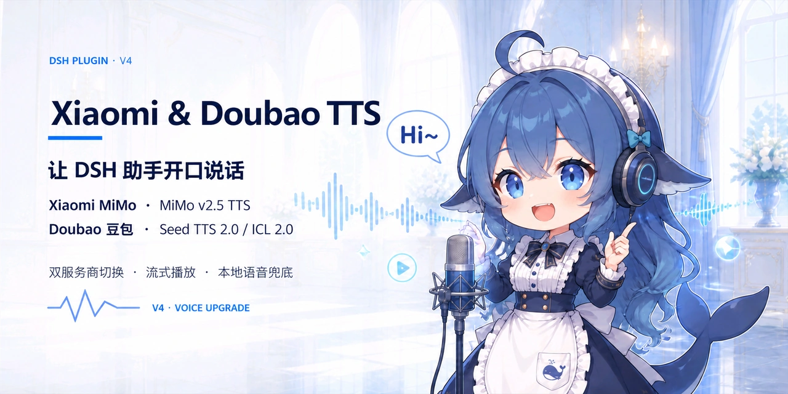
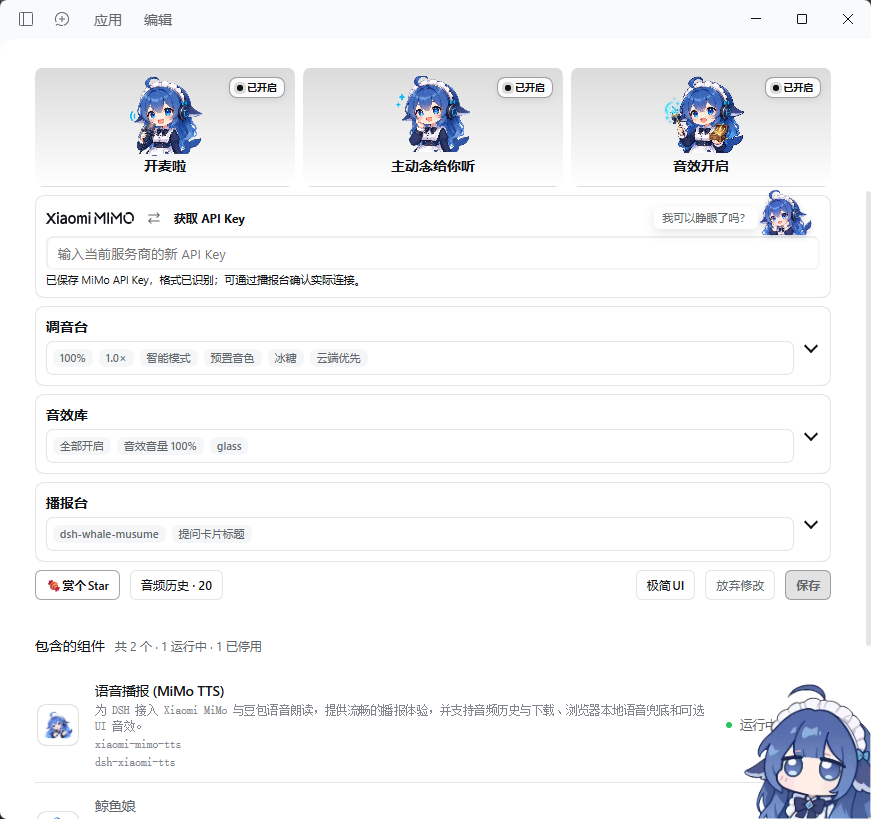
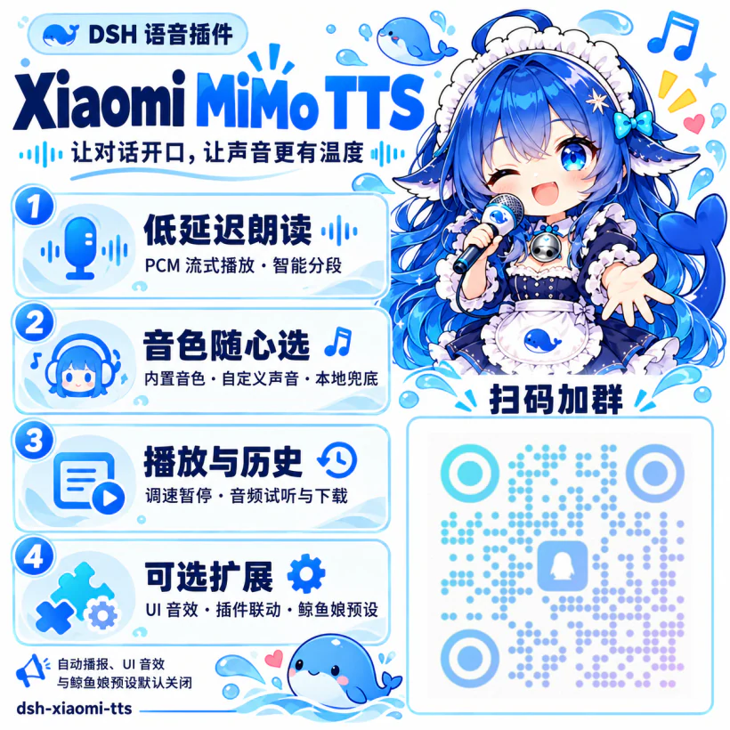

<p align="center">
  
</p>

<h1 align="center">dsh-xiaomi-tts</h1>

<p align="center">
  <a href="https://www.npmjs.com/package/dsh-xiaomi-tts"></a>
  <a href="https://www.npmjs.com/package/dsh-xiaomi-tts"></a>
  
  <a href="https://github.com/deepseek-ai/deepseek-harness"></a>
  <a href="https://awesome-dsh-plugin.com"></a>
</p>

<p align="center">为 DSH 添加 Xiaomi MiMo 与豆包语音朗读、浏览器本地语音兜底和可选 UI 音效。</p>

> 云端语音的计费以对应服务商的官方政策为准。

## 🎨 预览

<p align="center">
  <a href="https://ppy-web.github.io/dsh-plugin-xiaomi-mimo-tts"></a>
</p>

<p align="center">QQ 群 交流·建议：<code>1104616387</code> · 扫描海报二维码</p>

<table width="100%">
  <tr>
    <td align="center" valign="middle" width="50%"></td>
    <td align="center" valign="middle" width="50%"></td>
  </tr>
</table>

## ✨ 功能

- **消息朗读**：一键朗读或自动播报，过滤网址、代码等内容。
- **双服务商**：支持小米 MiMo、豆包流式语音，以及内置、自定义和复刻音色。
- **本地语音**：浏览器语音开箱即用，可设为优先或云端兜底。
- **播放控制**：0.5×–2.0× 语速、音量、暂停、继续、停止及音频历史。
- **设置与音效**：独立“语音朗读”设置页可调音色、朗读音量、朗读语速和朗读范围，并控制自动播报与 UI 音效。
- **扩展联动**：提供插件语音接口，附带可选的鲸鱼娘 Agent 预设。

## 📋 环境要求

- DSH `0.1.7-x` 至 `0.2.x`，当前目标版本为 `0.2.1-rc.3`；Node.js 22.13+。
- 云端语音需要对应 API Key；豆包还需开通所选语音资源。
- 豆包持续文本输入要求 DSH Host 支持 WebSocket upgrade 注册；桌面端使用 DSH 提供的 Host 流连接地址，Web 端使用页面部署地址，反向代理需转发 Upgrade。

## 🚀 安装

在 DSH 桌面端或 Web 端的插件管理面板搜索 `dsh-xiaomi-tts` 安装。

Web 端也可通过命令安装：

```bash
dsh plugin --profile web add dsh-xiaomi-tts@latest
```

 使用[社区插件市场](https://awesome-dsh-plugin.com)时，在「设置 → 插件市场」搜索 `xiaomi-mimo-tts`。

Web 端卸载：

```bash
dsh plugin --profile web remove dsh-xiaomi-tts
```

## 🐋 首次使用

安装后可直接用浏览器语音朗读，**自动播报和 UI 音效默认关闭**。启用云端语音：

1. 点击顶部开关区的服务商按钮切换小米 MiMo／豆包，填写对应的[小米 Key](https://platform.xiaomimimo.com/console/api-keys) 或[豆包 Key](https://console.volcengine.com/speech/new/setting/apikeys?projectName=default)并保存。
2. 在“调音台”选择模型、音色，在“播报台”试听。密钥须先保存，模型和音色可用草稿试听。
3. 按需开启自动播报和音效，保存配置。

## ⚙️ 配置说明

### 服务商与音色

切换服务商后需保存；两家的密钥、模型、音色和语音指令分别保留。

| 模型 | 音色配置 |
| --- | --- |
| 小米内置（`mimo-v2.5-tts`） | 中文：冰糖、茉莉、苏打、白桦；英文：Mia、Chloe、Milo、Dean。 |
| 小米音色设计（`mimo-v2.5-tts-voicedesign`） | 选择预设，或填写音色描述。 |
| 豆包标准合成（`seed-tts-2.0`） | 选择内置音色，或填写标准音色 ID。 |
| 豆包声音复刻（`seed-icl-2.0`） | [创建音色](https://console.volcengine.com/speech/new/experience/clone?projectName=default)后填写音色 ID，不能为空。 |

语音指令支持情绪、风格和方言，可选标签或自行编辑；效果因模型、音色和文本而异。本地语音与豆包复刻不应用指令。

豆包按密钥自动选择线路：`ark-` 开头的火山方舟 Ark API Key 直接连接 [Agent Plan 个人版语音](https://docs.volcengine.com/docs/6561/2532486?lang=zh)线路；其他格式先连接标准线路，握手返回 401 或 403 时再尝试 Agent Plan。使用 Agent Plan 时填写套餐专属 API Key，个人版文档列出的语音合成模型为 `seed-tts-2.0`。Coding Plan 不包含语音模型。

豆包自定义和复刻音色 ID 各保留最近 10 条历史，失焦或按 Enter 记住，点击标签回填。

豆包语速调整对下一次合成生效，历史录音保留原语速；小米流式调速可能改变音调。

官方文档：[小米 TTS](https://mimo.mi.com/models/zh-CN/mimo-v2.5-tts) · [豆包音色](https://docs.volcengine.com/docs/DoubaoVoice/Tonelist-1?lang=zh) · [语音指令示例](https://docs.volcengine.com/docs/DoubaoVoice/DoubaoTextToSpeech20CapabilityIntroduction?lang=zh)。

### 浏览器本地语音

- **云端优先**：云端在播放前失败时，尝试浏览器语音。
- **本地优先**：先用浏览器语音，失败后尝试云端。
- **关闭本地语音**：仅使用所选云端服务。

本地音色由 Web Speech API 提供，语言、声音及离线能力取决于浏览器和系统。云端已开始播放后出错，不会从头重播或自动切换服务商。

### 朗读范围

- **智能模式**：自动读开头两个语义段，必要时补收尾提示；手动读全文。
- **全文模式**：自动和手动都读全文。
- **首段模式**：自动和手动都只读首个语义段。

### 设置入口与播报来源

在「设置 → 语音朗读」顶部切换 Xiaomi-MiMo / Doubao-Seed，再调整音色、朗读音量、朗读语速、朗读范围、自动播报和音效，与插件设置卡片共用配置。服务商切换立即生效，各服务商的音色和密钥配置分别保留。

页面右上角提供源码、QQ 群二维码和插件设置入口。语音关闭、当前服务商密钥缺失或音色未配置时，会显示可关闭的提醒，并提供相应设置入口。

“播报台”提供文字试听和来源开关：

收起时也可点击摘要中的“试听”标签播放或停止；来源开关分为宿主播报与第三方插件联动。

| 来源 | 默认 | 说明 |
| --- | --- | --- |
| `dsh-pet` | 关闭 | 桌宠播报联动。 |
| `dsh-whale-musume` | 开启 | 控制对外语音接口。 |
| 提问卡片标题 | 开启 | 需同时开启自动播报；翻题、提交、关闭或切换会话时停止。 |
| 审批提醒 | 关闭 | 独立于自动播报；审批处理或撤回后停止。 |
| 后台任务结果 | 关闭 | 独立于自动播报；需宿主 `jobs` 服务，仅在观察到任务从运行转为完成、失败或取消时播报。 |

提问、审批和后台任务仅播报当前会话的新事件，旧记录不补播；审批和任务提醒忙碌时跳过，宿主缺少对应服务时不可用。

同一浏览器的同源 DSH 页面由最近聚焦的页面播放，切页会停止旧页音频，旧回复不补播。切到其他网站或应用可继续后台播放；此协调不跨浏览器、设备或域名 / 端口，禁用本地存储时仅聚焦页播放。

## 🔌 三方插件联动

通过可选服务调用当前服务商的语音：

```ts
import type { XiaomiMimoTtsService } from 'dsh-xiaomi-tts/client-api'

const tts = ctx.get('xiaomiMimoTts') as XiaomiMimoTtsService | undefined
tts?.play('欢迎回来')
```

通过 `ctx.get()` 动态获取服务，避免声明为必需注入。插件未安装、未就绪或关闭时跳过；新播放会中断当前朗读，可用 `tts?.stop()` 停止。

## 🐳 鲸鱼娘 Agent 预设

默认关闭。在「设置 → 插件 → 本插件 → 包含的组件」开启“鲸鱼娘”，新建会话时选择该 Agent 预设。

预设支持文件读写、联网查询、交互提问和对话压缩，附带 44 张[本地表情包](skills/whale-girl/memes.json)，无法显示时使用文字。人设与关键词参考 [DeepSeek-chan Meme Pack](https://github.com/the-beating-light-of-the-nail/deepseek-chan-meme-pack)。

## 🔒 隐私与网络访问

- API Key 由 DSH Host 保存，浏览器只读取配置状态；豆包连接由 Host 代理，文本和音色 ID 仅提交给所选服务商。
- Web Speech API 的在线音色可能向浏览器、系统或其网络语音服务发送文本。
- 成功生成的云端音频存于浏览器 IndexedDB，最多 100 条 / 100 MB，可在「音频历史」试听、下载。流式 PCM 保存为 24 kHz 单声道 WAV，本地语音无法导出。
- 音效核心移植自 [uisfx 0.4.0](https://github.com/romainsimon/uisfx)，采用 MIT License，详见 [NOTICE](NOTICE)。

## 🛠️ 开发

本地预览渲染 `src/client/settings/card.tsx` 和独立的“语音朗读”设置页：

```bash
pnpm install --frozen-lockfile
pnpm dev
```

预览服务会监听局域网接口，可在同一网络的其他设备上访问终端输出的 Network 地址。

常用检查：

```bash
pnpm typecheck
pnpm test
pnpm dev:build
pnpm pack:check
```

`pnpm build` 构建插件；`pnpm profile:check` 验证本机 DSH Web profile 安装状态。

Windows 本地开发链接切换为 npm 包：先停止 DSH Web，再运行：

```powershell
.\tools\start\dsh-plugin-reinstall.bat 4.2.4
```

清理 Desktop 残留的本地链接：退出 Desktop 后运行：

```powershell
.\tools\start\dsh-plugin-uninstall-local-link.bat desktop
```

## 🤝 推荐

- [dsh-deep-whale](https://github.com/Small-tailqwq/dsh-deep-whale#readme) · 鲸鱼娘主题皮肤系列。
- [dsh-whale-musume](https://github.com/Sutera-Diffusus/dsh-whale-musume#readme) · 元气鲸鱼娘桌宠，支持语音联动。
- [dsh-pet](https://github.com/PC2005-cloud/dsh-pet#readme) · 蓝色大肥鱼桌宠，支持播报联动。
- [dsh-plugin-uisfx](https://github.com/XanthanL/dsh-plugin-uisfx#readme) · 语义化 UI 音效。本项目已内置。
- [dsh-dream-skin](https://github.com/RevolutionLA/dsh-dream-skin#readme) · 原生换肤、背景壁纸、强调色和主题包。

## Star History

<a href="https://www.star-history.com/?repos=ppy-web%2Fdsh-plugin-xiaomi-mimo-tts&type=timeline&logscale=&legend=bottom-right">
 <picture>
   <source media="(prefers-color-scheme: dark)" srcset="https://api.star-history.com/chart?repos=ppy-web/dsh-plugin-xiaomi-mimo-tts&type=timeline&theme=dark&legend=bottom-right" />
   <source media="(prefers-color-scheme: light)" srcset="https://api.star-history.com/chart?repos=ppy-web/dsh-plugin-xiaomi-mimo-tts&type=timeline&legend=bottom-right" />
   
 </picture>
</a>
